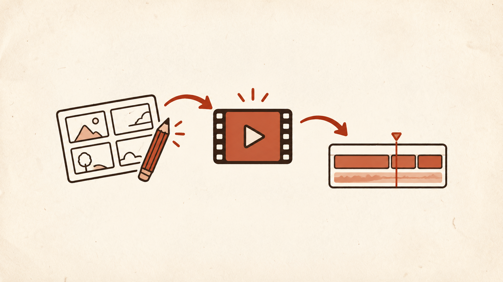

# video-skills



**Skills for making videos, from the first idea to the final cut.**

A video takes more than a prompt: it needs a story, a visual approach, motion that serves the idea, and an edit that holds together. These skills give an agent practical workflows for each part, including ways to inspect the actual output before calling it done.

They are designed for skill-aware agents such as Codex, Claude Code, and Hermes Agent. Some workflows need additional software, services, or companion skills; see [requirements](#requirements) below.

## The skills

| Stage | Skill | What it does |
|---|---|---|
| Story | [launch-posts](skills/launch-posts/) | Create a product announcement and composed video grounded in the real release. |
| Story | [video-script](skills/video-script/) | Shape the narrative, narration, dialogue, scene structure, and timing. |
| Story | [character-creation](skills/character-creation/) | Create reusable fictional characters and reference assets for a series. |
| Story | [storyboards](skills/storyboards/) | Turn a story or product journey into illustrated boards with a clear visual direction. |
| Direction | [video-direction](skills/video-direction/) | Plan shots, camera, lighting, continuity, reference roles, and visual treatments. |
| Direction | [reference-style-video](skills/reference-style-video/) | Analyze a reference video and carry its useful visual and timing mechanisms into a new piece. |
| Creation | [animation-explainer](skills/animation-explainer/) | Teach a concept through step-by-step visual explanations. |
| Creation | [image-generation-guide](skills/image-generation-guide/) | Brief, generate, and inspect still images for visual assets and keyframes. |
| Creation | [claude-cli](skills/claude-cli/) | Delegate animation and design work to Claude Code and verify the result. |
| Creation | [animation-creator](skills/animation-creator/) | Build and revise animations, motion graphics, and explainers using Claude and an appropriate renderer. |
| Creation | [image-to-video](skills/image-to-video/) | Animate a still image into a video clip with an appropriate generation tool. |
| Creation | [camera-3d-captions](skills/camera-3d-captions/) | Place captions in 3D space around a speaker and choreograph the camera. |
| Creation | [vox-explainer](skills/vox-explainer/) | Build a collage-style explainer from a topic or source material. |
| Finishing | [video-editor](skills/video-editor/) | Assemble footage, transitions, captions, and audio with local editing tools. |
| Finishing | [sound-storytelling](skills/sound-storytelling/) | Plan and review dialogue, effects, atmosphere, music, and silence against the shots. |
| Finishing | [content-iteration](skills/content-iteration/) | Carry creative feedback through revised artifacts and re-review. |
| Finishing | [creative-review](skills/creative-review/) | Review a video’s concept, execution, and payoff with concrete revision notes. |
| Research | [yt-dlp](skills/yt-dlp/) | Inspect and retrieve online media and subtitle tracks for reference research. |
| Finishing | [thumbnail](skills/thumbnail/) | Find or create a clear, truthful cover frame for a video. |

## Using a skill

Point a skill-aware agent at a skill's `SKILL.md`, or install the directories in your agent's skills folder. For example:

```text
Use video-script to turn these notes into a 60-second explainer.
Use animation-creator to animate this storyboard, then inspect the rendered video.
Use video-editor to assemble these clips and add captions.
```

To install the collection for Codex:

```sh
git clone https://github.com/exiao/video-skills.git
mkdir -p ~/.codex/skills
cp -R video-skills/skills/. ~/.codex/skills/
```

Check for existing skills first: copying can overwrite files with the same names. Install the collection together to retain links between its included skills. Other agents may use a different skills directory; refresh or restart the agent if it does not discover new skills.

## Requirements

Each skill contains its instructions and any included references, scripts, and assets. Some specialized workflows also call for companion skills, CLIs, installed renderers, external services, or paid providers that are not included here. External resources that are not packaged are marked in the instructions. Reference screenshots are omitted; the written descriptions remain.

The animation skill's p5 helper has its own setup script and package lock. Review scripts and provider costs before running them. The instructions include personal preferences and examples that you may want to adapt for your own environment.
